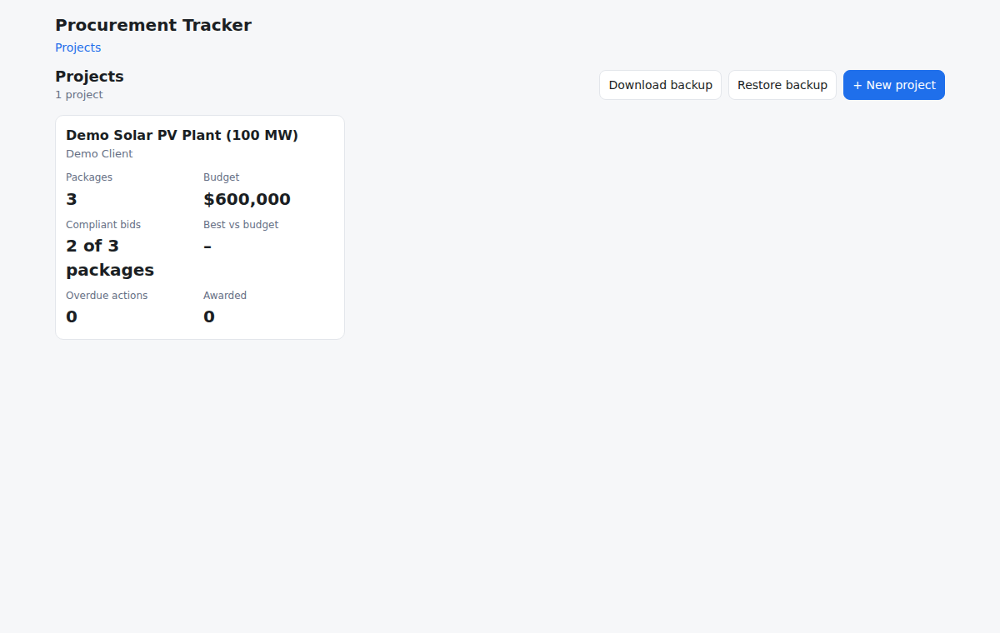
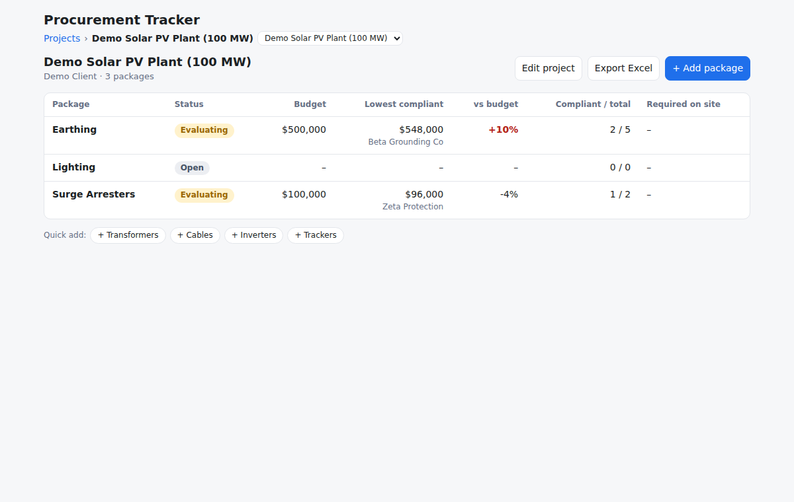
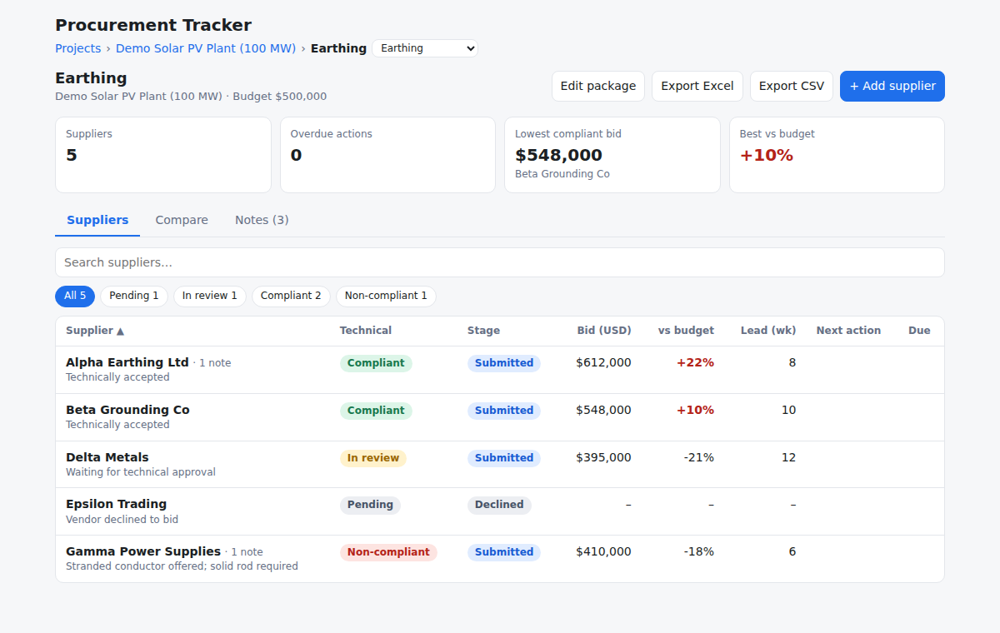
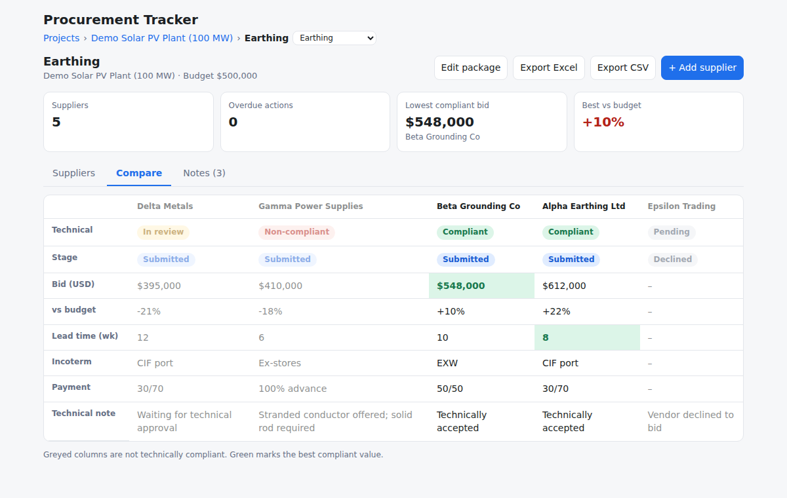
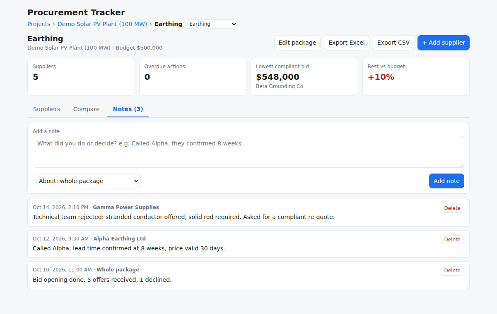

# Procurement Tracker (live database)

Track procurement **Projects > Packages > Suppliers**: technical and commercial status, bids against budget,
overdue actions, side-by-side comparison. Data lives in **PostgreSQL** (Neon), with real foreign keys and cascade deletes.

Stack: FastAPI + SQLAlchemy 2 + PostgreSQL, plain HTML/JS front end (no build step).

## Screenshots (fictional demo data)
| Projects | Packages |
|---|---|
|  |  |

| Suppliers | Compare |
|---|---|
|  |  |



## Features
- **Project > Package > Supplier** hierarchy with separate technical status and commercial stage
- **Compare tab:** suppliers side by side, non-compliant offers greyed, best compliant values highlighted
- **Notes log** on every package, optionally tied to one supplier. Notes are dated automatically and kept in the backup
- **Excel export:** per package (leveled comparison + notes) and per project (summary + one sheet per package). Variances are live formulas; sheets print landscape, one page wide. Needs Excel 2019 or Microsoft 365 (uses MINIFS)
- **Backup / restore** as one JSON file

## Deploy (browser only, free)
1. **Neon:** create a free project at neon.com, copy the connection string (starts with `postgresql://`).
2. **GitHub:** upload this folder to a **private** repo (drag and drop in the browser).
3. **Render:** New > Blueprint > pick the repo. Set `DATABASE_URL` (Neon string), `APP_USER`, `APP_PASSWORD`.
4. Open the `onrender.com` link and log in. Tables are created automatically on first start, and new tables (such as notes) are added automatically when you update an existing deployment.
5. Optional demo data (fictional): run `python seed.py` once with `DATABASE_URL` set, or just add your own.

## Back up your data (important)
Neon's free plan only keeps a short restore window (about 6 hours). Use **Download backup** on the Projects page
weekly. **Restore backup** merges a backup file back in (same ids are overwritten, others kept).

## Run locally
```bash
pip install -r requirements.txt
uvicorn app:app --reload          # uses sqlite:///tracker.db unless DATABASE_URL is set
pytest                            # tests (use a throwaway database, never your real one)
```

## Files
| File | Purpose |
|---|---|
| `app.py` | API, database tables, login, notes, backup/restore, export routes |
| `export_xlsx.py` | Builds the Excel workbooks |
| `static/` | `index.html`, `main.js` (screens), `store.js` (talks to the API), `style.css` |
| `schema.sql` | Reference schema and an example analytics query |
| `seed.py` | Fictional demo data |
| `test_api.py` | Tests: hierarchy, foreign keys, cascade delete, backup/restore, login |
| `render.yaml` | Free Render deploy config |

## Hosting notes
This app is a long-running Python server, so **Render** (free web service) is the simplest fit and is what `render.yaml` configures.
Vercel can also run FastAPI (it detects an `app` in `app.py`), but static files must move to `public/` and every request runs as a short serverless function; that variant is not set up or tested here.

## Notes
- Free Render services sleep after about 15 minutes idle; Neon's free compute sleeps after 5. The first request after a pause is slow.
- Never commit real vendor names, prices or connection strings.
